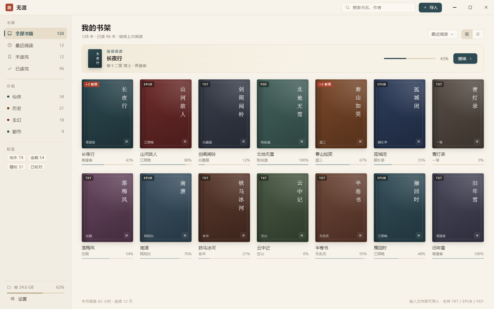

# 无涯 · Wuya Reader

> 书山有路勤为径，学海无涯苦作舟。

一个**纯本地**的中文小说阅读器：Windows 桌面版（Electron）+ 安卓版（Capacitor）。

不联网、不注册、不上传任何书籍内容；导入 TXT / EPUB / PDF 后即可阅读，支持书签、笔记、全文搜索、目录校正、朗读（本地神经音色）、阅读统计，以及两端互通的 `.wuya` 备份包。



## 特性

### 阅读

- **两种阅读模式**：分页（CSS 多栏排版，跨章连续翻页）与上下滚动（章节无缝衔接）
- **排版可调**：字号、行距、段距、页边距、宋体/楷体/黑体、五种纸色主题（纸白/米黄/护眼/夜间/纯黑）
- **翻页动画**：平移 / 覆盖 / 淡入 / 无
- **进度锚点**：精确到「章 + 段 + 页」，换字号、换模式、重启都能回到原处
- **跨章阅读**：分页模式左右点跨章（章首左点 = 上一章末页）；滚动模式上滚自动接上一章、下滚接下一章

### 内容

- **TXT**：自动探测编码（BOM / UTF-8 / GB18030 / Big5 / UTF-16），清洗广告与硬换行
- **目录识别**：正则 + 打分 + 动态规划选链，支持「卷 / 章」两级，可人工校正
- **EPUB**：OPF spine 拆章、nav/NCX 目录、内置图片
- **PDF**：pdf.js 原样渲染，缩放、双页对开、夜间反色、页内搜索、选中文字记笔记

### 辅助

- 书签、笔记、全文搜索（跳到命中处并高亮）
- 阅读统计：今日时长、连续天数、14 天柱状图、书目排行
- 自动翻页 / 自动滚动：按你的实际阅读节奏放慢 10% 推荐速度
- 阅读常亮：关闭 / 5 分 / 10 分 / 自定义 3–30 分
- **朗读**：系统 TTS 兜底 + 本地神经音色（离线），预合成消除句间停顿，锁屏/通知栏控制
- `.wuya` 备份包：书架、正文、书签、笔记、统计一并打包，桌面与手机互通

## 两个平台

| | 桌面版 | 安卓版 |
|---|---|---|
| 技术栈 | Electron 33 + React 19 + TypeScript | Capacitor 8 + React 19 + TypeScript |
| 版本 | 0.21.0 | 0.4.1 |
| 安装 | NSIS 安装包 / 便携版 | APK（arm64） |
| 朗读 | GPT-SoVITS 本地服务（克隆音色） | 本地 sherpa-onnx（Piper / Matcha / MeloTTS）或系统 TTS |
| 数据目录 | `%APPDATA%\无涯\` | App 私有目录 `files/` |

## 下载

编译好的安装包不放在仓库里，请到 **Releases** 页面下载：

- `Wuya-0.21.0-x64.exe` / `Wuya-0.21.0-portable.exe`（桌面版）
- `Wuya-Mobile-0.4.1-debug.apk`（安卓版）
- 音色包：`Matcha-zh-baker.zip`（推荐）、`Piper-zh_CN-huayan-x_low.zip`、`MeloTTS-zh_en-int8.zip`

> 音色包体积较大（18–75MB），未纳入仓库；也可自行从 sherpa-onnx 模型库获取。

## 仓库结构

```
.
├─ desktop/                 # Windows 桌面版（Electron）
│  ├─ src/
│  │  ├─ main/             # 主进程：书库、导入、TTS、备份、IPC
│  │  ├─ preload/          # 安全桥
│  │  └─ renderer/         # React 界面
│  ├─ build/               # 应用图标
│  └─ package.json
├─ mobile/                  # 安卓版（Capacitor）
│  ├─ app/
│  │  ├─ src/              # React 界面、core 解析、platform 适配、store
│  │  ├─ android/          # 原生工程（含音量键、朗读、启动页等插件）
│  │  └─ package.json
└─ docs/                    # 文档与截图
   ├─ 用户手册.md
   ├─ 设计文档.md
   ├─ 踩坑与修复.md
   └─ CHANGELOG.md
```

## 快速开始

### 桌面版

需要 Node.js 20+ 与 pnpm。

```bash
cd desktop
pnpm install
pnpm dev        # 开发（HMR）
pnpm build      # 构建到 out/
pnpm dist       # 打包 NSIS 安装版 + 便携版（输出 release/）
```

国内网络打包建议设置镜像：

```powershell
$env:ELECTRON_MIRROR = "https://npmmirror.com/mirrors/electron/"
$env:ELECTRON_BUILDER_BINARIES_MIRROR = "https://npmmirror.com/mirrors/electron-builder-binaries/"
```

### 安卓版

需要 JDK 21、Android SDK（platform 35、build-tools 35）、Node.js 20+。

```bash
cd mobile/app
pnpm install
pnpm build
npx cap sync android
cd android
./gradlew assembleDebug      # 产物：app/build/outputs/apk/debug/app-debug.apk
```

> 仓库已内置 sherpa-onnx 的 Java API 与 arm64 JNI 库，`abiFilters` 只保留 `arm64-v8a`。
> 音色包（模型文件）体积较大，不随仓库分发，见下方「音色包」。

## 音色包

安卓版的本地朗读需要单独导入模型（导入后完全离线）：

| 音色包 | 体积 | 特点 | 合成速度 |
|---|---|---|---|
| Piper zh_CN-huayan x_low | 18 MB | 女声，体积最小 | RTF ≈ 0.03 |
| **Matcha zh-baker（推荐）** | 74.8 MB | 标贝女声，标准普通话 | RTF ≈ 0.05 |
| MeloTTS zh_en int8 | 35.8 MB | 中英混排自然，但很慢 | RTF ≈ 1.3 |

RTF（实时比）在 PC 上测得：数值越小越快，0.05 表示合成 1 秒语音约需 50 毫秒。

导入方式：手机版「设置 → 本地音色包 → 导入音色包」，选择 zip 即可（原生流式解压，不需要电脑配合）。

## 数据与隐私

- 所有书籍、进度、笔记只保存在本机，**没有任何网络请求**（除手机版首次下载音色包，可完全离线导入）；
- 桌面版 `WUYA_DATA_DIR` 环境变量可自定义数据目录；
- `.wuya` 备份包是标准 zip，解压即可查看内容（`manifest.json`、`library.json`、`books/<id>/...`）。

## 许可

代码以 MIT 许可发布，详见 [LICENSE](LICENSE)。
字体、朗读引擎、模型等第三方组件的许可见 [NOTICE.md](NOTICE.md)。

## 更多文档

- [用户手册](docs/用户手册.md)
- [设计文档](docs/设计文档.md)
- [踩坑与修复](docs/踩坑与修复.md)
- [更新日志](docs/CHANGELOG.md)
