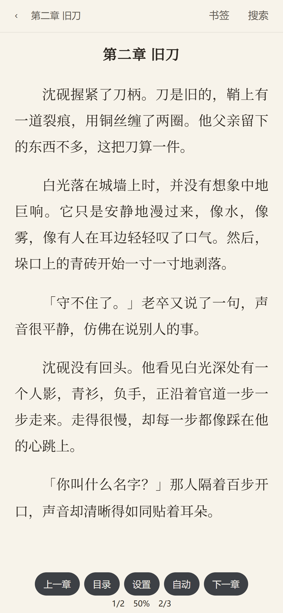
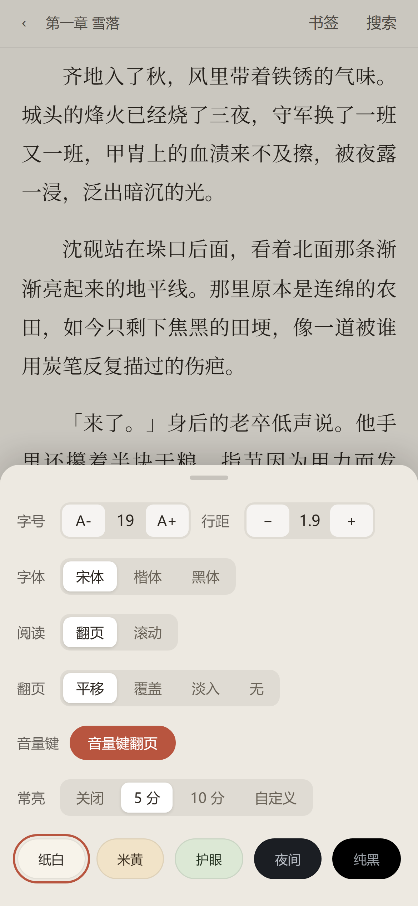
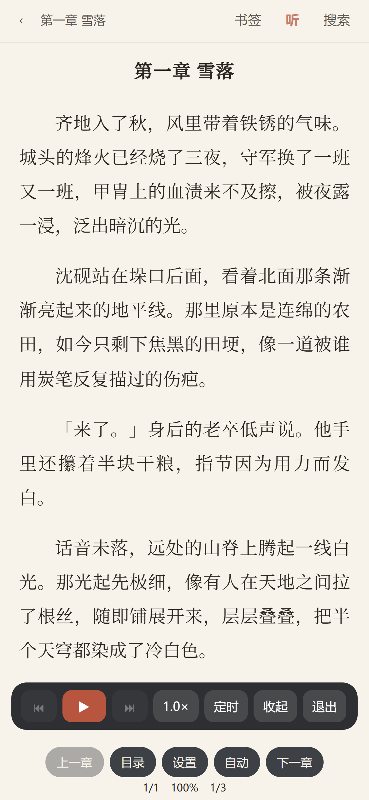
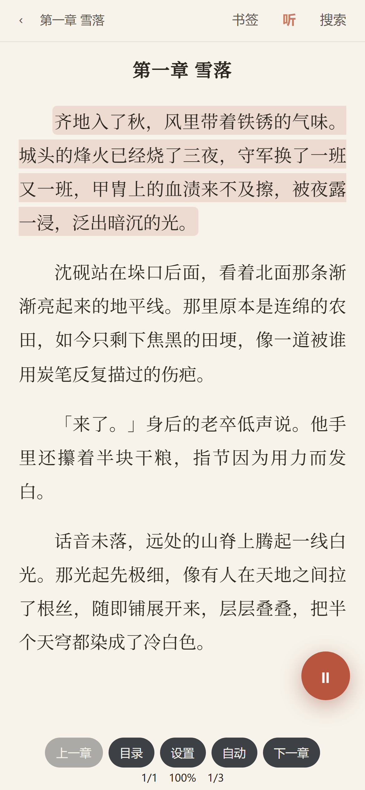

# 无涯 · 用户手册

适用于桌面版 0.21.0 与安卓版 0.4.1。两版功能基本一致，差异处会注明。

---

## 一、安装

### 桌面版（Windows）

- **安装版**：`Wuya-x.x.x-x64.exe`，可选安装目录，创建桌面/开始菜单快捷方式，可在「应用和功能」卸载。
- **便携版**：`Wuya-x.x.x-portable.exe`，双击即用，不写注册表。

首次运行 Windows SmartScreen 可能拦截：点「更多信息 → 仍要运行」。

数据放在 `%APPDATA%\无涯\`（卸载不会删除）。想换位置可设置环境变量 `WUYA_DATA_DIR`。

### 安卓版

1. 下载 `Wuya-Mobile-x.x.x-debug.apk`；
2. 允许「安装未知来源应用」后安装；
3. 首次启动会显示启动页（涯字 + 题诗），约 1.5 秒后进入书架。

> 只支持 arm64 设备（近几年所有主流手机）。

---

## 二、书架


- **导入书籍**：右上 `⋯ → 导入书籍`，或点书架里的「+ 导入」；支持一次多选 TXT / EPUB / PDF。
- **打开书籍**：点封面。
- **切换视图**：`全部` / `最近`。
- **长按书籍 2 秒**：重命名 / 目录编辑 / 删除 / 隐藏（隐藏暂未开放）。
- **阅读统计**：`⋯ → 阅读统计`，看今日时长、连续天数、14 天柱状图、书目排行。
- **备份与恢复**：`⋯ → 备份与恢复`，导出 `.wuya` 包或导入（见第七节）。

桌面版另有：顶部搜索框按书名/作者即时筛选、拖拽文件到窗口导入、全库正文搜索。

---

## 三、阅读



### 手势与点击区

| 位置 | 作用 |
|---|---|
| 正文左侧 ~30% | 上一页（章首时 = 上一章最后一页） |
| 正文右侧 ~30% | 下一页（章末时 = 下一章第一页） |
| 正文中间 | 显示/隐藏上下工具条 |
| 安卓返回键 | 阅读页 → 书架；书架单击提示「再按一次退出」，2 秒内再按才弹退出确认 |

### 顶部栏

`‹` 返回书架 · 章节名 · **书签**（当前段加/取消）· **听**（展开朗读面板）· **搜索**（目录抽屉的搜索页签）

### 底部工具条

`上一章` · `目录` · `设置` · `自动` · `下一章`

- **目录**：抽屉含四个页签——目录 / 书签 / 笔记 / 搜索。点目录项跳转；搜索框输入关键词，结果带上下文，点结果跳转。
- **设置**：字号、行距、字体、阅读模式、翻页动画、音量键翻页、阅读常亮、朗读音色、本地音色包。
- **自动**：自动翻页或自动滚动，见第五节。

### 快捷键（桌面版）

`←/→`、`空格`、`PgUp/PgDn` 翻页 · `M` 切换分页/滚动 · `Ctrl+F` 页内搜索（PDF）· `Esc` 退出阅读。

---

## 四、阅读设置



| 项 | 说明 |
|---|---|
| 字号 | 14–32 |
| 行距 | 1.2–2.4 |
| 字体 | 宋体 / 楷体 / 黑体（内置开源字体） |
| 阅读 | 翻页（多栏分页）/ 滚动（章节无缝衔接） |
| 翻页 | 平移 / 覆盖 / 淡入 / 无（滚动模式下不可用） |
| 音量键 | 开启后音量键翻页（仅翻页模式；滚动模式恢复系统音量） |
| 常亮 | 关闭 / 5 分 / 10 分 / 自定义 3–30 分。无翻页或滚动超过设定时间自动放开常亮 |
| 朗读 | 系统语音 / 本地音色 |
| 本地音色包 | 导入 / 删除模型，显示已安装体积与预热耗时 |

主题在设置面板底部：纸白 / 米黄 / 护眼 / 夜间 / 纯黑。

---

## 五、自动阅读

点底部「自动」打开面板：

- **速度**：翻页模式为「每 N 秒翻一页」（2–120 秒，0.5 秒步进）；滚动模式为「N 像素/秒」。
- **用我的阅读速度**：按你最近几次手动翻页/滚动的节奏，**放慢 10%** 后给出推荐值（翻页需 ≥3 次手动翻页，滚动需 ≥1 秒采样）。
- **开始 / 停止**：运行中按钮显示「自动中」。退出阅读页会自动停止。

滚动模式用逐帧推进（每帧累加分数像素），不是逐行跳，观感接近匀速传送带。

---

## 六、朗读

### 6.1 展开面板

点顶部「听」**只会展开朗读面板**，不会立刻出声：



| 按钮 | 作用 |
|---|---|
| ⏮ / ⏭ | 上一句 / 下一句（未开始时置灰） |
| ▶ | 开始朗读；再次点击为暂停/继续 |
| 1.0× | 语速循环 0.8 / 1.0 / 1.2 / 1.5 / 1.8 |
| 定时 | 15 / 30 / 60 分钟，到点自动停 |
| 收起 | 收成右下角悬浮球（朗读继续） |
| 退出 | 停止朗读并关闭面板 |

### 6.2 悬浮球

朗读中可以点「收起」变成悬浮球，继续听；点球恢复面板；也可以点正文中间唤出工具条后点「听」切换。



### 6.3 朗读行为

- 从**当前页第一段**开始读；读完本章自动读下一章，直到书末或定时结束；
- 高亮为**段落级、单块最多 5 行**，长段落切成多个高亮块跟随；
- 翻页模式自动翻到当前朗读块所在页；滚动模式把高亮块滚到屏幕中间；
- 锁屏/通知栏/蓝牙耳机可以上一句、暂停、下一句；来电自动暂停；
- 朗读进度写入阅读进度，下次打开能续上。

### 6.4 音色

| 引擎 | 说明 |
|---|---|
| 系统语音 | 使用手机自带 TTS（Honor/vivo 一般自带中文），零下载，音色偏播报 |
| 本地音色 | sherpa-onnx 离线神经音色，需要先导入音色包（见下） |

**导入音色包**：把 zip 放到手机（微信/数据线均可）→ 设置 → 本地音色包 → 导入音色包 → 系统文件选择器里选中 zip。导入为原生流式解压，约 5–15 秒完成，成功后显示「已导入 N 个文件，音色包已就绪（预热 xxx ms）」。

推荐音色包：

- **Matcha zh-baker**（74.8MB）：标贝女声，标准普通话，速度快，**推荐**；
- Piper zh_CN-huayan x_low（18MB）：体积最小，速度最快，但腔调偏重；
- MeloTTS zh_en（35.8MB）：中英混排自然，但合成速度只有实时的 1/13，句间会明显停顿，**不建议用于长听**。

桌面版朗读走本机 GPT-SoVITS 接口（克隆音色），需先启动 GPT-SoVITS API 服务。

---

## 七、备份与恢复（.wuya）

`书架 → ⋯ → 备份与恢复`：

- **导出备份**：生成 `无涯备份-YYYYMMDD-HHmm.wuya`，包含书架索引、正文、目录、书签、笔记、阅读统计、PDF 原文件；
- **导入备份**：桌面与手机**双向互通**，按书籍 id 合并（已存在的跳过），统计按天取较大值，不会重复累加。

包内结构（可直接用压缩软件打开）：

```
manifest.json     # 版本、平台、导出时间、书籍数
library.json      # 书架索引与进度
stats.json        # 阅读时长
books/<id>/
  content.txt  toc.json  meta.json  marks.json  notes.json
  source.pdf                      # 若是 PDF
```

---

## 八、常见问题

**Q：导入 TXT 后目录识别不准？**
A：长按书籍 →「目录编辑」，可从任意一行拆分、合并到下一章、改名、设卷、删除，支持撤销与恢复自动识别。结果写入 sidecar，不动原文件。

**Q：分页模式正文空白？**
A：多为切换模式后未重新测量舞台，请升级到最新版（0.3.0 起已修复）。

**Q：点「听」没反应？**
A：0.3.5 之前存在加载线程被合成循环阻塞的问题；0.4.1 起「听」只展开面板，点 ▶ 才开始。若仍无反应，检查是否提示「本地音色未就绪」——可在设置里重新导入音色包。

**Q：朗读句间停顿很久？**
A：MeloTTS 太慢所致（RTF≈1.3）。换 Matcha 或 Piper 音色包即可（RTF 0.03–0.05）。

**Q：导入音色包闪退/卡住？**
A：0.3.9 起改为原生流式解压，不再把 75MB 读进 JS 内存；0.4.0 起修正了 Capacitor 8 的 ActivityResult 回调，取消选择后按钮也会立即恢复。

**Q：APK 为什么接近 48MB？**
A：内置 sherpa-onnx 推理库（arm64，约 31MB）。音色包不随 APK 分发。

**Q：桌面版能读到手机进度吗？**
A：可以，用 `.wuya` 备份包导入即可。
